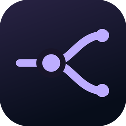
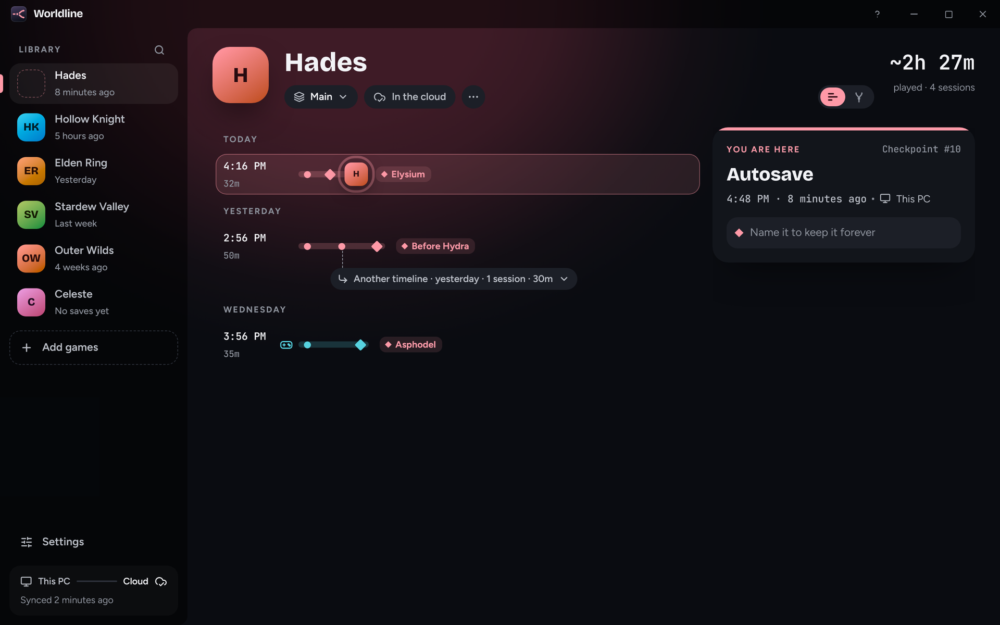
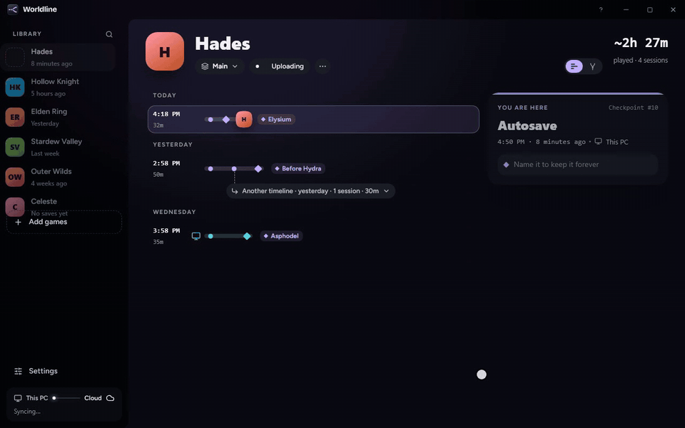
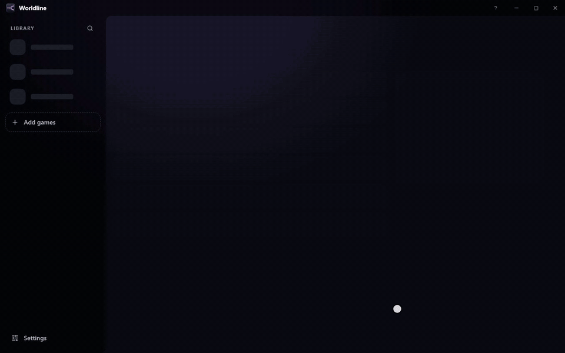
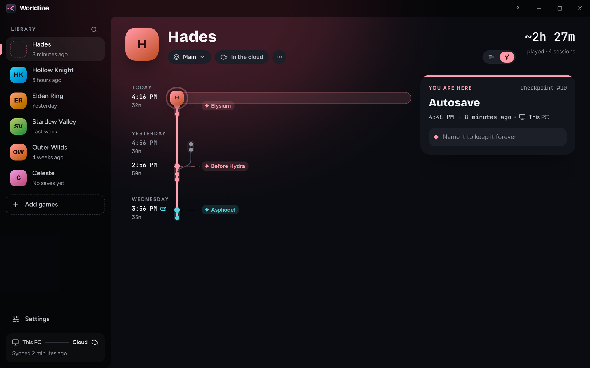
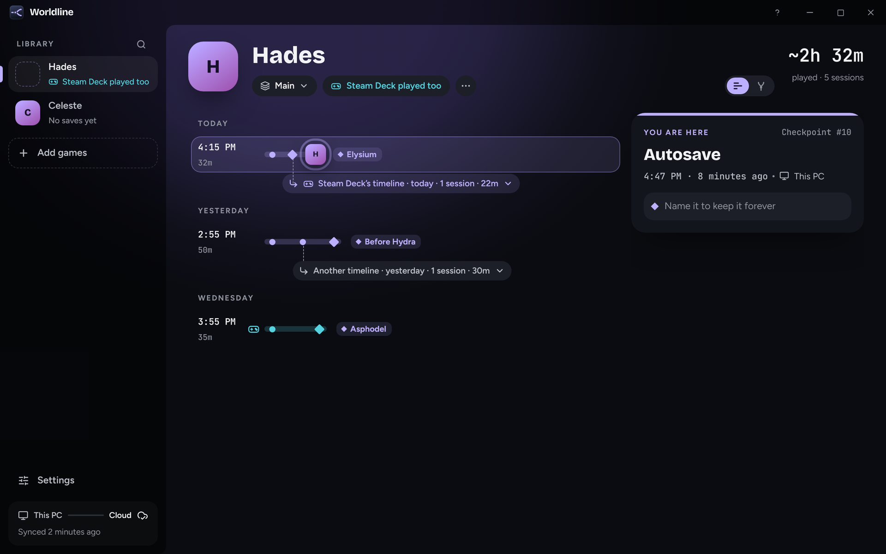
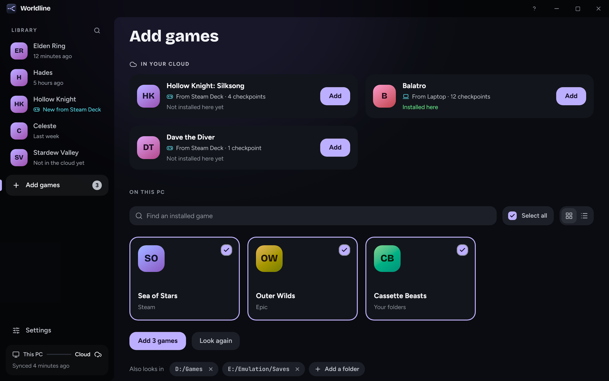
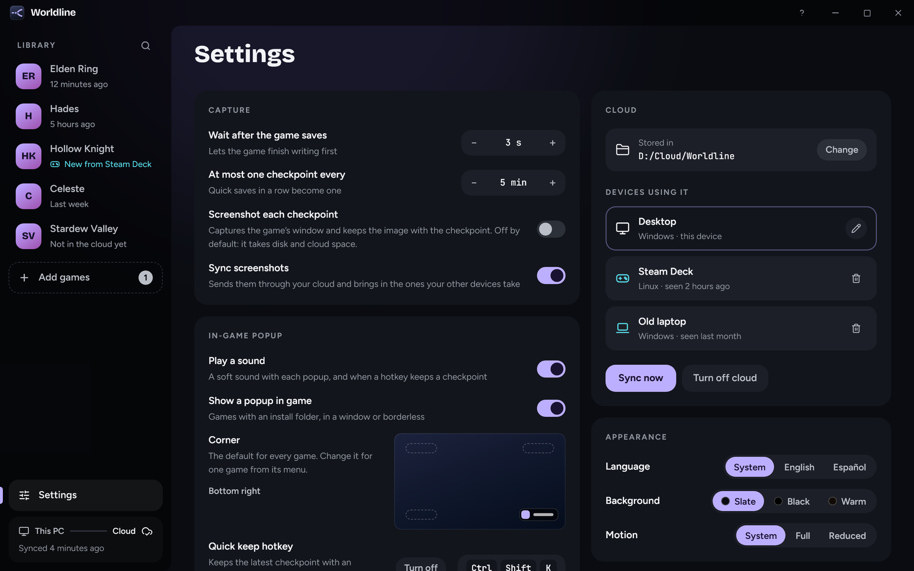

<div align="center">



# Worldline

**Every save. Every timeline.**

Worldline backs up your game saves while you play and lets you rewind to any of them.<br>
Made a bad call? Rewind. Want the other path too? Keep both.

[](https://github.com/agustinmorantes/savegame-timeline/actions/workflows/ci.yml)
[](LICENSE)


[Download](#installation) · [How it works](#how-it-works) · [Features](#features) · [Build from source](#building-from-source) · [Docs](docs/)



</div>

## Why

Games save over your old file, even after a disaster. Overwrite a save after a bad choice, a corrupted autosave or a boss fight gone wrong, and that progress is gone. Moving between a PC and a handheld means copying save folders by hand and hoping you picked the newer one.

Worldline watches your games' save folders and keeps every save as a **checkpoint** on a timeline. You don't press anything. When you want to go back, hold a button. Nothing is ever overwritten: if you rewind and play on, the old run splits off into its own **timeline**, and you can switch back whenever you like.

## How it works

<div align="center">

</div>

1. **Just play.** Every time the game saves, Worldline keeps a copy. Saves in quick succession become one checkpoint, and unchanged saves aren't stored again.
2. **Made a bad call?** Pick an earlier checkpoint and hold to rewind. Worldline checkpoints what you have now first, so a rewind can always be undone.
3. **Take the other path.** Play on from there and your new saves start a new timeline next to the old one. Jump between them at any time.

Name a checkpoint ("Before Malenia") to keep it forever. Unnamed ones are thinned out over time according to your retention settings.

## Features

- **Automatic checkpoints.** Watches save folders and captures them as the game writes, with no setup per game beyond picking it.
- **Rewind safely.** Restores are all-or-nothing: if the game holds a file, your saves stay exactly as they were ([how](docs/adr/0008-live-saves-change-atomically-or-not-at-all.md)).
- **Branching timelines.** Nothing is overwritten. Rewinding and playing on, or playing offline on two devices, keeps both lines.
- **Two views.** *Sessions* groups checkpoints by when you played; *Graph* shows every timeline on one axis.
- **Finds your games.** Scans Steam, Epic and your own folders, and knows where thousands of games keep their saves thanks to the [Ludusavi manifest](https://github.com/mtkennerly/ludusavi-manifest).
- **Sync between devices** through any folder you already sync (Dropbox, OneDrive, Google Drive, Syncthing, a NAS). No account and no server. Progress from your Steam Deck shows up on your PC; if both moved on, both runs are kept and you choose.
- **Playthroughs.** Keep separate histories for separate runs of the same game.
- **In-game popup and hotkeys** (Windows). A small popup tells you when a checkpoint was kept. *Quick keep* and *Name it* hotkeys save a moment without leaving the game. The popup is a separate window: nothing is injected into the game.
- **A screenshot of each checkpoint** (Windows 11), so you can see where you were.
- **Small on disk.** Saves are deduplicated, chunked and compressed with zstd. Unchanged data is stored once across every checkpoint.
- **Your data stays readable.** History is plain files and zstd chunks. You can [recover a save by hand](docs/storage-format.md) without the app.
- **Export and import** a game's whole history as a portable `.zip`.
- **A full CLI** for everything the app does, plus repository checks and recovery tools.
- English and Spanish. Lives in the tray.

<div align="center">

</div>

<table>
  <tr>
    <td width="50%"><br><sub><b>Graph view.</b> Every timeline on one axis, named checkpoints as labels.</sub></td>
    <td width="50%"><br><sub><b>Sync.</b> The Steam Deck played on; its run shows up as its own timeline.</sub></td>
  </tr>
  <tr>
    <td width="50%"><br><sub><b>Add games.</b> Games from your other devices, and the ones installed here.</sub></td>
    <td width="50%"><br><sub><b>Settings.</b> Capture timing, the in-game popup, devices and appearance.</sub></td>
  </tr>
</table>

## Installation

Download the latest installer from [**Releases**](https://github.com/agustinmorantes/savegame-timeline/releases):

| Platform | Package |
|---|---|
| Windows 10 and 11 | the `x64-setup.exe` installer |
| Linux (Debian, Ubuntu and derivatives) | the `amd64.deb` package |

The Windows installer isn't code-signed yet, so SmartScreen may warn you: choose **More info → Run anyway**. On other Linux distributions, [build from source](#building-from-source).

## Getting started

1. Open Worldline. A 30-second tour shows the basics; replay it any time from **?** in the title bar.
2. Click **Add games** and **Look for installed games**. Pick the ones you want; Worldline fills in their save folders. You can also add a game by hand and choose its save folders.
3. Play. Checkpoints appear on the game's timeline as it saves. Closing the window keeps Worldline running in the tray; right-click the tray icon to exit.
4. To go back, select a checkpoint and **hold to rewind**. Close the game first: Worldline refuses to rewind a game it sees running, since the game could save over the result.

### Syncing between devices

In **Settings → Cloud**, choose a folder that your sync tool of choice keeps in step between devices, and do the same on each device. From then on it's automatic: new checkpoints reach the folder as they're created, and other devices' progress is picked up every few minutes. When another device simply played further, its progress is applied here. Games installed on this device that another one tracks are added for you. If two devices both played on from the same point, both runs are kept as timelines and you choose which one to continue; nothing is merged or discarded for you.

### Command line

Everything the app does is also available from the CLI, which works on the same data:

```sh
cargo run -p cli -- games list
cargo run -p cli -- watch          # capture without the app
cargo run -p cli -- --help
```

See [docs/cli.md](docs/cli.md) for every command.

## Where your data lives

History is stored in `%LOCALAPPDATA%\agustinmorantes.worldline` on Windows and `~/.local/share/agustinmorantes.worldline` on Linux. It is plain files plus compressed chunks; the database next to it is only an index that can be rebuilt. [docs/storage-format.md](docs/storage-format.md) describes the layout and how to rebuild a save with nothing but `zstd`.

## Building from source

You need a current [Rust](https://rustup.rs/) toolchain and [Bun](https://bun.sh/). On Linux, also install the [Tauri v2 prerequisites](https://v2.tauri.app/start/prerequisites/) for your distribution, including WebKitGTK 4.1 and the appindicator development library.

```sh
git clone https://github.com/agustinmorantes/savegame-timeline.git
cd savegame-timeline/gui
bun install --frozen-lockfile
bun run tauri dev      # run the app
bun run tauri build    # build an installer into target/release/bundle/
```

Linux packages should be built on Linux. The checked-in Ludusavi manifest is an empty placeholder; release builds fetch the real one (see [`.github/workflows/bundles.yml`](.github/workflows/bundles.yml)), and the app downloads it at runtime otherwise.

To work on the UI without the Rust backend, `bun run dev:mock` serves it in a browser with made-up data.

## Development

```sh
cargo fmt --all --check
cargo clippy --workspace --all-targets -- -D warnings
cargo test --workspace
cd gui
bun run check          # eslint + tsc
bun run test -- --run  # unit tests (Vitest)
bun run test:screens   # screen tests on the mocked UI (Playwright)
bun run build
```

The workspace has three parts: `worldline-core/` owns all behavior, and `cli/` and `gui/src-tauri/` are thin adapters over it. The React UI is in `gui/src/`. Read [docs/architecture.md](docs/architecture.md) for the big picture, the [decision records](docs/adr/) for the reasoning, and [CONTRIBUTING.md](CONTRIBUTING.md) before sending a change.

## Acknowledgements

Worldline was built by [Agustín Morantes](https://github.com/agustinmorantes) as a final project at [ITBA](https://www.itba.edu.ar/) (Instituto Tecnológico de Buenos Aires), with Federico Bond as academic advisor.

Game discovery relies on the [Ludusavi manifest](https://github.com/mtkennerly/ludusavi-manifest) by Matthew T. Kennerly and its contributors.

## License

[MIT](LICENSE)
